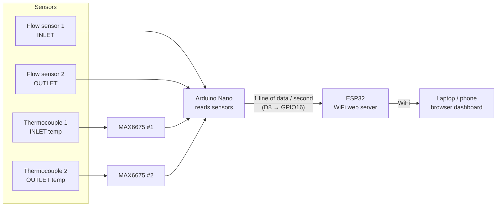
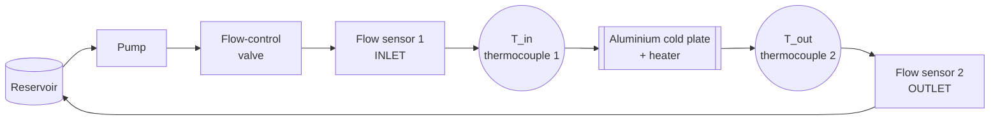

# THERMAX Hardware Guide (Beginner Friendly)

This guide explains **every part** of the THERMAX cold plate test rig, **what it does**, and **exactly how to connect it**, step by step. No prior electronics experience is assumed.

> **Read the [Safety](#1-safety-first) section before you start.** This project mixes **water**, **heat** and **electricity**.

---

## Contents

1. [Safety first](#1-safety-first)
2. [What the project does](#2-what-the-project-does)
3. [Parts list](#3-parts-list)
4. [Meet the components](#4-meet-the-components)
5. [Basic electronics you need to know](#5-basic-electronics-you-need-to-know)
6. [The coolant loop (plumbing)](#6-the-coolant-loop-plumbing)
7. [Wiring, step by step](#7-wiring-step-by-step)
8. [Complete wiring summary](#8-complete-wiring-summary)
9. [Software setup](#9-software-setup)
10. [Uploading the code](#10-uploading-the-code)
11. [Testing in stages](#11-testing-in-stages)
12. [Using the dashboard](#12-using-the-dashboard)
13. [Running an experiment](#13-running-an-experiment)
14. [Troubleshooting](#14-troubleshooting)
15. [Glossary](#15-glossary)

---

## 1. Safety first

- **Keep water away from the electronics.** Mount the Nano, ESP32 and breadboard **above** and **away** from the tubes and plate. A drip tray under the plumbing is a good idea.
- **Leak-test the loop with the electronics unplugged.** Run the pump with only water for 10 minutes and check every joint with tissue paper.
- **The heater gets hot.** Never touch the plate while it is running. Add a thermal cut-off (thermal fuse / bimetal switch) to the heater if possible.
- **Never power the pump or heater from the Arduino or ESP32 pins.** They need their own power supply. An Arduino pin can only supply ~20 mA; a pump needs hundreds.
- **Mains (230 V AC) heaters are dangerous.** If your heater runs on mains, have it wired by someone qualified, use proper insulated connectors, and keep it on an earthed, switched socket. A low-voltage DC heater (e.g. 12 V power resistors or a cartridge heater on a bench supply) is much safer for beginners.
- **Do not run the heater without coolant flowing.** The plate will overheat.
- **Unplug everything before changing any wiring.**

---

## 2. What the project does

Water is pumped through an aluminium plate that is being heated. We measure how much water flows **in** and **out**, and how hot the water is **before** and **after** the plate. From that we can calculate **how much heat the water carried away**.



**Why two boards?**

| Board | Job | Why |
| :--- | :--- | :--- |
| **Arduino Nano** | Reads all sensors | Simple, 5 V, very reliable at counting flow-sensor pulses |
| **ESP32** | Hosts the website over WiFi | Has built-in WiFi, the Nano does not |

The key formula (from the project report):

```
Q̇ = ṁ × Cp × (T_out − T_in)
```

| Symbol | Meaning | Unit | Where it comes from |
| :--- | :--- | :--- | :--- |
| Q̇ | Heat removed by the water | W (watts) | Calculated |
| ṁ | Mass of water flowing per second | kg/s | Flow sensors (L/min ÷ 60 × 1 kg/L) |
| Cp | Heat capacity of water | 4186 J/kg·K | Constant |
| T_out − T_in | How much the water warmed up (ΔT) | °C | Thermocouples |

**Example:** 1 L/min of water warming up by 3 °C → (1/60) × 4186 × 3 ≈ **209 W** removed.

---

## 3. Parts list

### Electronics

| Qty | Part | Notes |
| :--- | :--- | :--- |
| 1 | **Arduino Nano** (ATmega328P) | Clones with the **CH340** USB chip are fine |
| 1 | **ESP32 DevKit** (ESP32-WROOM-32, 30 or 38 pin) | Usually has a **CP2102** or CH340 USB chip |
| 2 | **SEN-HZ21WA** water flow sensor (G1/2") | Hall-effect pulse output, 3 wires |
| 2 | **MAX6675 module** | Thermocouple amplifier board |
| 2 | **K-type thermocouple** | Often sold together with the MAX6675 module. A probe/screw type that can sit **in the water stream** is best |
| 1 | **1 kΩ resistor** | For the voltage divider (brown-black-red) |
| 1 | **2 kΩ resistor** | For the voltage divider (red-black-red). Two 1 kΩ in series also works |
| 1 | Breadboard (830 points) | |
| ~30 | Jumper wires (male-male and male-female) | |
| 2 | USB cables | Must be **data** cables, not charge-only. Check the connector type of your boards (Mini-USB / Micro-USB / USB-C) |

### Plumbing & thermal

| Qty | Part | Notes |
| :--- | :--- | :--- |
| 1 | **Aluminium plate** 235 × 170 × 10 mm | With Ø3 mm drilled passages forming a **sealed, continuous** channel |
| 1 | **Heater** | Pad, cartridge or power resistors clamped to the plate. Note its power (W) |
| 1 | **Water pump** (e.g. 12 V DC) | With its **own** power supply |
| 1 | **Reservoir** | Any container with inlet/outlet fittings |
| 1 | **Flow-control valve** | To set different flow rates |
| — | Tubes, hose clamps, G1/2" adapters | To fit the flow sensors and plate |
| — | Thermal paste | Between heater and plate |
| — | Sealant / PTFE tape | For threaded joints |

### Optional

| Part | Why |
| :--- | :--- |
| 2 × pressure transducers (e.g. 0.5–4.5 V output) | To measure pressure drop ΔP across the plate |
| Multimeter | **Highly recommended** for checking voltages and connections |

---

## 4. Meet the components

### 4.1 Arduino Nano

A small microcontroller board. It runs our sensor-reading program (`src/nano_main.cpp`) over and over.

```
                 ┌──────[USB]──────┐
           D13 ──┤●               ●├── D12
           3V3 ──┤●               ●├── D11
          AREF ──┤●               ●├── D10
            A0 ──┤●               ●├── D9   (not used)
            A1 ──┤●               ●├── D8   → to ESP32 (via divider)
            A2 ──┤●    ARDUINO    ●├── D7   → MAX6675 #2 CS
            A3 ──┤●      NANO     ●├── D6   → MAX6675 SCK (both)
            A4 ──┤●               ●├── D5   → MAX6675 #1 CS
            A5 ──┤●               ●├── D4   → MAX6675 SO  (both)
            A6 ──┤●               ●├── D3   → Flow sensor 2 (yellow)
            A7 ──┤●               ●├── D2   → Flow sensor 1 (yellow)
            5V ──┤●  ← 5 V power  ●├── GND
           RST ──┤●               ●├── RST
           GND ──┤●               ●├── RX0  (don't use)
           VIN ──┤●               ●├── TX1  (don't use)
                 └─────────────────┘
```

> Pin labels are printed on the board. **Always read the label on your board**, as layouts can differ slightly between clones.

- **5V / GND**: power for the sensors.
- **D2, D3**: special pins that can react instantly to a pulse ("interrupts"), so no flow pulse is missed.
- **D13**: connected to the on-board LED. Our program **blinks it once per second** so you can see it is running.
- **TX1 / RX0**: used by USB for uploading. **Leave them unconnected.**

### 4.2 ESP32 DevKit

A more powerful board with **WiFi**. It runs `src/esp32_main.cpp`, receives the data from the Nano, and serves the dashboard web page.

- **GPIO16 (often labelled RX2)**: receives the Nano's data.
- **GND**: must be connected to the Nano's GND.
- **VIN (or 5V)**: 5 V from USB, can power the Nano.
- **EN / RST button**: restarts the ESP32.
- **BOOT button**: hold it while uploading if the upload fails (see [Troubleshooting](#14-troubleshooting)).

> ⚠️ **The ESP32 works at 3.3 V.** Its pins can be **damaged by 5 V**. That is why we need a voltage divider between the Nano (5 V) and the ESP32 (see 5.3).

### 4.3 SEN-HZ21WA flow sensor

Inside is a small **turbine wheel with a magnet**. As water flows, the wheel spins, and a **Hall-effect sensor** produces one electrical pulse per small amount of water. More flow = faster pulses.

| Wire | Connect to |
| :--- | :--- |
| 🔴 **Red** | 5V |
| ⚫ **Black** | GND |
| 🟡 **Yellow** | Signal (D2 for inlet, D3 for outlet) |

- There is an **arrow on the sensor body**. Water must flow **in the direction of the arrow**.
- The program converts pulses to litres per minute using `Q = F / 10` (10 pulses per second = 1 L/min). **Check your sensor's datasheet**: if it says a different number (e.g. `F = 7.5 × Q` or `F = 11 × Q`), change the `/ 10.0` in `src/nano_main.cpp`. Every flow and heat number depends on this.

### 4.4 MAX6675 + K-type thermocouple

A **thermocouple** is two different metal wires joined at the tip. Heating the tip creates a tiny voltage (microvolts). The **MAX6675** board amplifies this, converts it to a number, and sends it to the Nano.

- Range 0–1024 °C, resolution **0.25 °C**, accuracy about **±2 °C**.
- The thermocouple connects to the **screw terminals** marked **+** and **−**.
- **Polarity matters.** If the temperature goes **down** when you heat the tip, swap the two thermocouple wires.

| MAX6675 pin | Meaning | Connect to (module #1 / #2) |
| :--- | :--- | :--- |
| **VCC** | Power | 5V |
| **GND** | Ground | GND |
| **SCK** | Clock (the Nano "ticks" the data out) | D6 (shared by both modules) |
| **SO** | Serial Out (the data) | D4 (shared by both modules) |
| **CS** | Chip Select ("you, talk now") | **D5** for #1, **D7** for #2 |

**Why can two modules share SCK and SO?** Each module only talks when its **CS** pin is pulled LOW by the Nano. The Nano asks module #1 first (D5), then module #2 (D7), so they never talk at the same time.

---

## 5. Basic electronics you need to know

### 5.1 Breadboard

```
   +  -   a b c d e   f g h i j   +  -
   ●  ●   ● ● ● ● ●   ● ● ● ● ●   ●  ●   row 1
   ●  ●   ● ● ● ● ●   ● ● ● ● ●   ●  ●   row 2
   ●  ●   ● ● ● ● ●   ● ● ● ● ●   ●  ●   row 3
   │  │   └─ joined ┘ └─ joined ┘ │  │
   │  └ long rails: whole column joined
```

- The **5 holes in a row** (a–e) are connected to each other. So are f–j. The gap in the middle separates them.
- The long **+ / −** rails run the full length and are used for **5V** and **GND**.
- Put the Nano across the middle gap so each pin gets its own row.

### 5.2 Common ground (GND)

A voltage is always measured **between two points**. For the Nano's signal to mean anything to the ESP32, **both boards must share the same GND**. A missing GND wire is the **#1 reason** "the Nano is not sending data".

> **Rule:** connect **all** GNDs together (Nano, ESP32, both flow sensors, both MAX6675).

### 5.3 The voltage divider (5 V → 3.3 V)

The Nano sends its data at **5 V**. The ESP32 only tolerates **3.3 V**. Two resistors "divide" the voltage:

```
 Nano D8 (0 V or 5 V)
     │
   [1 kΩ]   R1
     │
     ├────────────► ESP32 GPIO16  (0 V or 3.3 V)
     │
   [2 kΩ]   R2
     │
    GND
```

```
V_out = V_in × R2 / (R1 + R2) = 5 × 2000 / (1000 + 2000) = 3.33 V ✔
```

- **Order matters!** If you swap them you get 5 × 1/3 = **1.67 V**, which the ESP32 does not recognise as "high" and **no data arrives**.
- Other pairs that work: **10 kΩ + 20 kΩ**, **2.2 kΩ + 3.3 kΩ** (gives 3.0 V), **1 kΩ + 1 kΩ + 1 kΩ** (top 1 kΩ, bottom two in series).
- **Check with a multimeter:** with the Nano running and nothing sending, GPIO16 should read about **3.3 V** to GND.

### 5.4 Resistor colour codes

| Value | Bands (4-band) |
| :--- | :--- |
| 1 kΩ | brown, black, red, gold |
| 2 kΩ | red, black, red, gold |
| 10 kΩ | brown, black, orange, gold |
| 20 kΩ | red, black, orange, gold |

---

## 6. The coolant loop (plumbing)



Order of parts along the tube:

1. **Reservoir** → **Pump** → **Valve** (to adjust flow)
2. **Flow sensor 1** (arrow pointing toward the plate)
3. **Thermocouple 1** (T_in) as close as possible to the plate inlet
4. **Cold plate** (heater clamped on top with thermal paste)
5. **Thermocouple 2** (T_out) as close as possible to the plate outlet
6. **Flow sensor 2** (arrow pointing toward the reservoir)
7. Back to the **reservoir**

**Tips**

- **Thermocouple placement is critical.** The tip must sit **in the water**, not touch the tube wall or the hot plate. Use a T-fitting with the probe sealed through a hole (hot glue / epoxy / compression gland). Both probes should be installed the **same way** so they read the same.
- **Insulate** the tube between the plate and thermocouple 2 so the water doesn't cool down before it's measured.
- **Bleed the air.** Air bubbles make flow sensors read wrong. Run the pump with the outlet higher than the inlet until no bubbles come out.
- The flow sensors need a **minimum flow** (often about 1 L/min) to spin reliably. Below that they may read 0.
- **Pressure sensors (optional):** place the taps **immediately before and after the plate**, not across the whole loop. Otherwise you also measure the pressure loss of the tubes and valve.

---

## 7. Wiring, step by step

> **Unplug both USB cables while wiring.** Tick each step after you complete it.

### Step 1: Power rails

- [ ] Place the Nano on the breadboard across the centre gap.
- [ ] Nano **5V** → breadboard **+** rail (red).
- [ ] Nano **GND** → breadboard **−** rail (blue/black).

From now on, "5V" means the + rail and "GND" means the − rail.

### Step 2: Flow sensor 1 (inlet)

- [ ] 🔴 Red → **5V** rail
- [ ] ⚫ Black → **GND** rail
- [ ] 🟡 Yellow → **D2**

### Step 3: Flow sensor 2 (outlet)

- [ ] 🔴 Red → **5V** rail
- [ ] ⚫ Black → **GND** rail
- [ ] 🟡 Yellow → **D3**

> No external resistor is needed on the yellow wires. The Nano's internal pull-up resistor is turned on in the code (`INPUT_PULLUP`).

### Step 4: MAX6675 #1 (inlet temperature)

- [ ] VCC → **5V** rail
- [ ] GND → **GND** rail
- [ ] SCK → **D6**
- [ ] SO → **D4**
- [ ] CS → **D5**
- [ ] Screw thermocouple 1 into its + / − terminals

### Step 5: MAX6675 #2 (outlet temperature)

- [ ] VCC → **5V** rail
- [ ] GND → **GND** rail
- [ ] SCK → **D6** (same row as module #1's SCK)
- [ ] SO → **D4** (same row as module #1's SO)
- [ ] CS → **D7** ← the only pin that is different
- [ ] Screw thermocouple 2 into its + / − terminals

### Step 6: Voltage divider and ESP32 link

- [ ] Place the ESP32 on the breadboard (or a second breadboard).
- [ ] **1 kΩ** resistor from Nano **D8** to an empty breadboard row (call it row **X**).
- [ ] **2 kΩ** resistor from row **X** to the **GND** rail.
- [ ] Jumper wire from row **X** to ESP32 **GPIO16 (RX2)**.
- [ ] ESP32 **GND** → **GND** rail. ⚠️ Do not skip this.

### Step 7: Power for the Nano (choose one)

- **Option A (easiest while testing):** plug **both** boards into the laptop by USB.
- **Option B (one USB cable):** ESP32 **VIN** (5 V from its USB) → Nano **5V**. Then only the ESP32 needs USB.

> Don't connect both options at once and don't connect the Nano's **VIN** to 5 V. VIN expects 7–12 V.

### Step 8: Double-check before power-on

- [ ] No wire connects **5V directly to GND** (short circuit).
- [ ] Nothing is connected to Nano **TX1/RX0**.
- [ ] Nothing from the Nano goes to the ESP32 **without** passing through the divider.
- [ ] All GNDs are joined.

---

## 8. Complete wiring summary

### Arduino Nano

| Nano pin | Connected to | Purpose |
| :--- | :--- | :--- |
| 5V | + rail → flow sensors (red), MAX6675 VCC ×2 | Sensor power |
| GND | − rail → flow sensors (black), MAX6675 GND ×2, ESP32 GND, 2 kΩ | Common ground |
| D2 | Flow sensor 1 yellow | Inlet flow pulses |
| D3 | Flow sensor 2 yellow | Outlet flow pulses |
| D4 | SO of both MAX6675 | Temperature data |
| D5 | CS of MAX6675 #1 | Select inlet sensor |
| D6 | SCK of both MAX6675 | Temperature clock |
| D7 | CS of MAX6675 #2 | Select outlet sensor |
| D8 | 1 kΩ → divider → ESP32 GPIO16 | Data to ESP32 (9600 baud) |
| D13 | On-board LED | Heartbeat blink |

### ESP32

| ESP32 pin | Connected to | Purpose |
| :--- | :--- | :--- |
| GPIO16 (RX2) | Divider middle point | Receives Nano data |
| GND | Common GND rail | Shared ground |
| VIN / 5V | Nano 5V (option B only) | Powers the Nano |
| GPIO17 (TX2) | Nothing | Not used |

### Full diagram

```
                         ┌─────────────── 5V rail ────────────────┐
                         │                                         │
  Flow 1 ─ red ──────────┤          ┌──────────────┐               │
         ─ black ────────┼─GND──────┤ GND      5V  ├───────────────┘
         ─ yellow ───────┼──────────┤ D2           │
  Flow 2 ─ red ──────────┤          │              │
         ─ black ────────┼─GND      │   ARDUINO    │
         ─ yellow ───────┼──────────┤ D3   NANO    │
                         │          │              │
  MAX6675 #1  VCC ───────┤          │              │
              GND ───────┼─GND      │              │
              SCK ───────┼──────┬───┤ D6           │
              SO  ───────┼───┬──┼───┤ D4           │
              CS  ───────┼───┼──┼───┤ D5           │
                         │   │  │   │              │
  MAX6675 #2  VCC ───────┘   │  │   │              │
              GND ─────GND   │  │   │              │
              SCK ───────────┼──┘   │              │
              SO  ───────────┘      │              │
              CS  ──────────────────┤ D7           │
                                    │           D8 ├──[1kΩ]──┬────────► ESP32 GPIO16 (RX2)
                                    └──────────────┘         │
                                                           [2kΩ]
                                                             │
                     GND rail ───────────────────────────────┴────────► ESP32 GND
```

---

## 9. Software setup

You only do this once per computer.

1. **Install [Visual Studio Code](https://code.visualstudio.com/).**
2. In VS Code, open **Extensions** (Ctrl+Shift+X), search **PlatformIO IDE**, and install it. Restart VS Code when asked.
3. **USB drivers** (Windows usually installs them automatically; install manually if the board doesn't appear):
   - Nano clones: **CH340** driver
   - ESP32: **CP210x** (Silicon Labs) or **CH340** driver
4. **Get the code:**
   ```bash
   git clone https://github.com/richsanj0-commits/THERMAX.git
   ```
   Then in VS Code: **File → Open Folder** → select the `THERMAX` folder. PlatformIO downloads the board tools and libraries automatically the first time (needs internet, takes a few minutes).
5. **Create your WiFi settings file:**
   - Copy `include/secrets.example.h` to `include/secrets.h`.
   - Open `secrets.h` and fill in your WiFi name (`WIFI_SSID`) and password (`WIFI_PASS`).
   - The ESP32 only works with **2.4 GHz** WiFi. If you use a **Windows laptop hotspot**, go to *Settings → Network & internet → Mobile hotspot → Edit* and set **Band: 2.4 GHz**.
   - `secrets.h` is never uploaded to GitHub, so your password stays private.

---

## 10. Uploading the code

The project contains code for **two** boards. PlatformIO calls each one an **environment**:

| Environment | Board | File |
| :--- | :--- | :--- |
| `nanoatmega328` (default) | Arduino Nano | `src/nano_main.cpp` |
| `esp32dev` | ESP32 | `src/esp32_main.cpp` |

> `src/main.cpp` is an older sketch and is **not** uploaded. Edit `nano_main.cpp` instead.

### Using the VS Code buttons

At the bottom of VS Code there is a blue/purple **PlatformIO toolbar**:

1. Click the environment selector (shows `env:...`) and choose the board you want.
2. Click **→ (Upload)**.
3. Click the **🔌 plug icon** to open the Serial Monitor.

### Using the terminal

```bash
pio run -e nanoatmega328 -t upload     # upload to Nano
pio run -e esp32dev -t upload          # upload to ESP32
pio device list                        # show which COM ports are connected
pio device monitor -e nanoatmega328    # watch Nano output
pio device monitor -e esp32dev         # watch ESP32 output
```

**Which COM port is which?** Run `pio device list`:

- `USB-SERIAL CH340` → usually the **Nano**
- `Silicon Labs CP210x` → usually the **ESP32**

The ESP32 port is set in `platformio.ini` (`upload_port = COM9`). If yours is different, change it. The Nano port is detected automatically. If both boards are plugged in and the Nano upload goes to the wrong board, unplug the ESP32 while uploading the Nano.

---

## 11. Testing in stages

Don't connect everything and hope. Test one piece at a time.

### Stage 1: Nano alone

1. Upload to the Nano and open its Serial Monitor (115200 baud).
2. You should see the D13 LED **blinking once per second** and lines like:
   ```
   [NANO Telemetry] {"f1":0.00,"v1":0,"f2":0.00,"v2":0,"t1":27.50,"t2":28.00}
   ```
3. **Temperatures:** hold each thermocouple tip in your fingers. `t1` or `t2` should rise to about 30–34 °C. A value of **0.00** means that sensor is not connected or its wiring is wrong.
4. **Flow:** blow gently through a flow sensor (or run water). `f1`/`f2` should go above 0.

### Stage 2: ESP32 alone

1. Upload to the ESP32 and open its Serial Monitor.
2. Press the **EN** button. You should see:
   ```
   === THERMAX - Cold Plate Cooling Optimization ===
   [WiFi] Connected to <your WiFi>
   [WiFi] Web Dashboard: http://192.168.x.x
   ```
   or, if your WiFi isn't found:
   ```
   [SoftAP] Hotspot: 'THERMAX-Dashboard'
   [SoftAP] Dashboard: http://192.168.4.1
   ```
3. Open that address in a browser. The dashboard should load and show **WAITING FOR NANO**.

### Stage 3: Nano → ESP32 link

1. Connect the divider and the shared GND (step 6).
2. Within a few seconds the dashboard pill should change to **LIVE TELEMETRY**, and **Packets** in the System panel should count up.

### Stage 4: Water

1. Fill the loop, start the pump **with the heater off**, and bleed out air.
2. Check that inlet and outlet flow are similar (the **Flow Balance** card says **CONSISTENT**).
3. Check that T_in and T_out read nearly the same. Then press **Zero ΔT (heater OFF)** to cancel the small difference between the two sensors.

### Stage 5: Heat

1. Turn on the heater.
2. T_out should rise above T_in and **Q̇** should become positive.

---

## 12. Using the dashboard

| Section | What it shows |
| :--- | :--- |
| **Status pills** (top right) | Connection state and the address to open |
| **Alerts** | Red/amber banners: high temperature, flow imbalance (leak/blockage), Nano not sending, sensors swapped |
| **Coolant Flow** | Inlet and outlet flow (L/min), total volume, and whether they match |
| **Thermal Performance** | T_in, T_out, temperature rise ΔT, heat removed Q̇. Enter the heater power to see what % of it the water captures |
| **Hydraulics** | Pressure drop ΔP (when pressure sensors are added) and **Steady State** |
| **Live Trends** | Last 2 minutes of temperature and flow |
| **Test Runs** | Record averaged data points and see Q̇ and ΔP vs flow rate |
| **System & Calibration** | Link health, WiFi signal, ΔT zero, raw-data download |

---

## 13. Running an experiment

The goal (from the project report) is to see how **heat removal** and **pressure drop** change with **flow rate** and **heater power**.

1. Start the pump with the heater **off**, bleed air, then press **Zero ΔT**.
2. Set the valve to the **lowest** flow you want to test.
3. Turn the heater on and type its power (W) into **Heater power**.
4. Wait until **Steady State** shows **STEADY / READY TO RECORD**. This can take several minutes because the plate has to warm up.
5. Type a label (e.g. `Valve 25%`) and click **● Record point**. The last 30 seconds are averaged and added to the table.
6. Open the valve a bit more and repeat steps 4–5 for 4–6 different flow rates.
7. Optionally repeat everything at a different heater power.
8. Click **⬇ Export results CSV** and open it in Excel for your report.

**Getting good results**

- Aim for a **ΔT of at least 2–3 °C**. The thermocouples are only accurate to about ±2 °C, so a tiny ΔT gives a very uncertain Q̇. Lower the flow or raise the heater power if ΔT is too small.
- **Q̇/Heater below 100%** is normal: some heat escapes to the air from the plate and tubes. Insulating the plate raises this.
- **Q̇/Heater above 100%** usually means the flow constant or the thermocouple zero is off.

---

## 14. Troubleshooting

| Problem | Likely cause | Fix |
| :--- | :--- | :--- |
| Upload fails: `could not open port 'COMx'` | Board is on a different COM port | `pio device list`, then update `upload_port` in `platformio.ini` (ESP32) or replug |
| Upload button uploads the wrong board | Wrong environment selected | Choose the right `env:` in the PlatformIO toolbar |
| ESP32 upload: `Wrong boot mode` / `Failed to connect` | Board didn't enter download mode | Hold **BOOT**, click Upload, release BOOT when `Connecting...` appears. Or just retry |
| Nano upload: `not in sync` / `stk500` errors | Old bootloader clone | In `platformio.ini` change `board = nanoatmega328new` to `board = nanoatmega328` |
| Board doesn't appear at all | Charge-only USB cable or missing driver | Try another cable; install CH340 / CP210x driver |
| ESP32 never connects to WiFi | 5 GHz network, wrong password, hotspot off | Use **2.4 GHz**; check `secrets.h`; turn off hotspot power saving; or use the `THERMAX-Dashboard` hotspot |
| Dashboard says **WAITING FOR NANO** | No data arriving on GPIO16 | Nano powered? (LED blinking?) Shared GND? D8 (not TX1) used? Divider not swapped (GPIO16 ≈ 3.3 V)? |
| **Packets** stays 0 but **errors** count up | Garbled data | Missing/loose GND, loose wire, very long wires |
| Temperature shows `--` / `Sensor offline` | MAX6675 wiring or thermocouple loose | Check CS pin (D5/D7), SO (D4), SCK (D6), screw terminals |
| Temperature goes **down** when heated | Thermocouple polarity reversed | Swap the two thermocouple wires at the screw terminals |
| T_out < T_in warning with heater on | Sensors swapped or not zeroed | Check which probe is where; press **Zero ΔT** with heater off |
| Flow reads 0 with water running | Flow too low, sensor backwards, or yellow wire on wrong pin | Check arrow direction; increase flow; D2/D3 |
| Flow jumps around | Air bubbles | Bleed the loop |
| **FLOW IMBALANCE** alert | Real leak, air, or sensors read differently | Check joints for leaks; bleed air; compare sensors by swapping them |
| Total volume resets | Nano restarted | Normal: it counts from power-on |

---

## 15. Glossary

| Term | Meaning |
| :--- | :--- |
| **Microcontroller** | A tiny computer on a chip that runs one program forever (the Nano and ESP32 are boards built around one) |
| **GPIO / pin** | A connection on the board that can read or send an electrical signal |
| **GND (ground)** | The 0 V reference point that all voltages are measured from |
| **Interrupt** | A pin feature that runs code instantly when a pulse arrives, so no pulse is missed |
| **Pull-up resistor** | Keeps a pin at "high" when nothing is pulling it low. The Nano has built-in ones |
| **Serial / UART** | Sending data one bit at a time over a wire. **Baud** = bits per second (we use 9600 between the boards) |
| **SoftwareSerial** | A serial port created in software on normal pins (D8/D9 on the Nano) |
| **SPI** | A fast way for chips to talk using clock (SCK), data (SO) and select (CS) wires. The MAX6675 uses it |
| **Voltage divider** | Two resistors that reduce a voltage to a safe level |
| **Thermocouple** | A temperature sensor made of two different metals |
| **Hall-effect sensor** | Detects a magnet passing by; used inside the flow sensor |
| **JSON** | A simple text format for data, e.g. `{"t1":27.5}` |
| **SoftAP** | The ESP32 making its own WiFi hotspot |
| **mDNS** | Lets you open `http://thermax.local` instead of typing an IP address |
| **Steady state** | When temperatures have stopped changing, so a measurement is meaningful |
